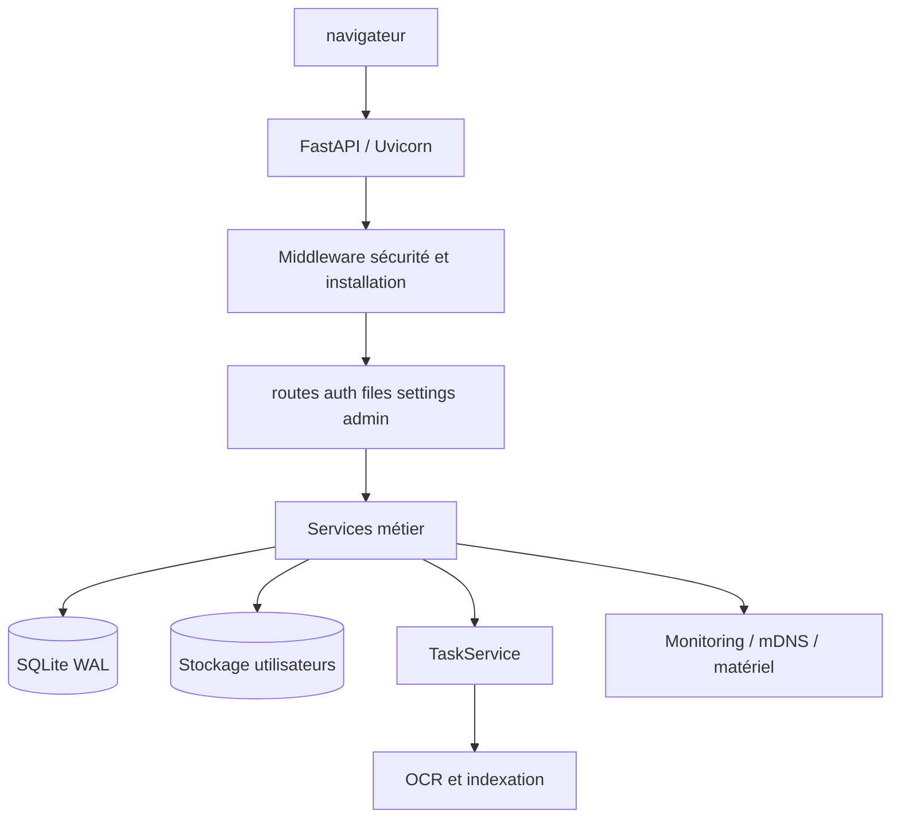

# Architecture GravityNAS

## Vue d'ensemble

GravityNAS est une application FastAPI monolithique organisée autour de services métier spécialisés. Le monolithe réduit le coût d'exploitation sur Raspberry Pi tout en séparant les responsabilités principales.

## Points d'entrée

- `main.py` construit l'application, configure les chemins, instancie les services et gère le cycle de vie.
- `routes/` expose les parcours HTTP et délègue aux services.
- `app/dependencies.py` contient les instances partagées et les dépendances FastAPI.
- `app/core/secure_fs.py` impose les limites de chemin avant tout accès disque.
- `static/` et `templates/` constituent l'interface web.

## Cycle de vie

Au démarrage, l'application :

1. Détermine les chemins de données et de stockage.
2. Crée les services et protège les permissions du coffre.
3. Démarre la file de tâches et mDNS.
4. Active le tunnel distant uniquement si les trois conditions de configuration sont réunies.
5. Lance le régulateur thermique et la maintenance périodique comme tâches nommées.

À l'arrêt, le contexte `lifespan` annule et attend explicitement les tâches périodiques, arrête mDNS et le tunnel, puis arrête les workers. Cette séquence évite les tâches orphelines et les réinitialisations partielles.

## Responsabilités des services

| Service | Responsabilité |
| --- | --- |
| `AuthManager` | Comptes, sessions, MFA, réglages et métadonnées. |
| `FileService` | Opérations fichiers, quotas, corbeille et métadonnées. |
| `SearchService` | Index et recherche plein texte, avec OCR en tâche de fond. |
| `TaskService` | File asynchrone bornée par un nombre de workers. |
| `MonitorService` | Statistiques CPU, mémoire, disque et température. |
| `HardwareService` | Ventilateur, GPIO et annonce mDNS quand disponibles. |
| `BackupService` | Archives et restauration de données applicatives. |
| `RemoteManager` | Cycle de vie du tunnel distant optionnel. |
| `ServiceManager` | Activation des services système administrables depuis l'interface. |

## Règles de robustesse

- Toute opération disque passe par une validation de chemin utilisateur.
- Les tâches lourdes ne doivent pas s'exécuter directement dans le thread de requête.
- Les workers sont idempotents au démarrage : appeler `start()` deux fois ne crée pas de seconde flotte.
- Les fonctionnalités distantes et matérielles restent optionnelles pour conserver un mode local portable.
- Les tests de régression ciblent actuellement la traversée de répertoires, la concurrence des verrous, la recherche et les sauvegardes.

## Extension recommandée

Pour ajouter une fonctionnalité :

1. Ajouter la logique dans un service métier testable.
2. Exposer uniquement le contrat nécessaire dans une route.
3. Ajouter un test de comportement avant d'ajouter l'intégration UI.
4. Documenter les variables d'environnement et les permissions requises dans [OPERATIONS.md](OPERATIONS.md).
5. Ne pas démarrer de thread ou de tâche globale au moment de l'import d'un module.
